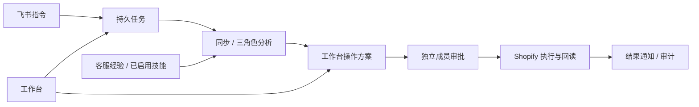

# 小跨 · AI 电商运营官

[](https://github.com/LyzJames/xiaokua-ai-operations-agent/actions/workflows/ci.yml)

小跨是面向跨境电商团队的 **AI Agent 应用**。它通过飞书接收运营指令，连接 Shopify 店铺，同步订单和库存、分析业务问题、处理经过审批的订单操作，并把客服经验整理为可复用的技能。

项目包含完整工作台、真实平台适配、持久任务、成员权限和审计记录。你可以先在本机体验，再接入自己的飞书、Shopify 和模型账号，按下文完成环境与业务配置后开展小范围试运营。当前首版围绕 **飞书 + Shopify**；Amazon、Meta 广告和采购支付保留扩展入口。

[快速开始](#快速开始) · [日常怎么用](#日常怎么用) · [开始试运营需要做什么](#开始试运营需要做什么) · [接入文档](docs/INTEGRATIONS.md) · [测试报告](docs/TEST_REPORT.md)


## 功能

| 功能 | 可以做什么 |
| --- | --- |
| 飞书办公入口 | 接收单聊中的同步与分析指令，发送任务结果，通过消息卡片批准或拒绝操作；支持官方 SDK 长连接和 HTTPS 回调 |
| 订单处理 | 同步 Shopify 订单，提出履约、物流信息更新、取消和原交易退款方案，审批后执行并核实平台结果 |
| 商品与库存 | 同步商品规格和库存，审查库存调整前后差异，更新商品的纯文本说明 |
| 多角色分析 | 用 LangGraph 并行组织订单、库存和客服知识三个角色，输出包含证据与限制的分析报告；可指定单笔订单 |
| 经验与技能 | 导入 CSV/JSON 客服记录，按市场与主题生成带证据的技能草稿，人工核对启用后在后续分析中复用；支持 Markdown 和 Agent Skills 技能包导出 |
| 审批与权限 | 负责人、审批人、运营人员和只读成员分工；所有业务写入均需另一成员审批，申请人不能自批，方案 24 小时后过期 |
| 任务与恢复 | 持久化任务队列、状态跟踪、事件去重和只读任务重试；外部写入结果未知时转人工核实 |
| 审计与管理 | 凭据加密、组织数据隔离、追加式哈希审计链、操作记录导出、隐私请求处理队列和运行状态查看 |

订单取消与退款分别审批；物流功能写入履约和运单信息，承运商轨迹、发货后退货物流、真实广告投放和采购付款仍需后续接入。模型负责分析，业务写入由审批流程控制。

## 快速开始

需要 Python 3.11–3.13、[uv](https://docs.astral.sh/uv/getting-started/installation/) 和 Node.js 22。Windows PowerShell、macOS 和 Linux 可使用下面的逐行命令。

```bash
git clone https://github.com/LyzJames/xiaokua-ai-operations-agent.git
cd xiaokua-ai-operations-agent
uv sync --frozen
cd frontend
npm ci
npm run build
cd ..
```

### 接入自己的账号

完整使用需要你自己的 **飞书自建应用、Shopify 店铺及应用权限、DeepSeek API Key**。先把 [.env.example](.env.example) 复制为 `.env`，填写私有配置；模型标识使用服务商实际开放的值。模型请求费用由自己的账号承担。

| 配置 | 用途 |
| --- | --- |
| `DEEPSEEK_API_KEY`、`DEEPSEEK_MODEL` | 三角色模型分析 |
| `SHOPIFY_SHOP_DOMAIN`、`SHOPIFY_CLIENT_ID`、`SHOPIFY_CLIENT_SECRET` | 店铺识别和应用认证；实际授权范围还需在 Shopify 配置 |
| `FEISHU_APP_ID`、`FEISHU_APP_SECRET` | 飞书应用认证 |
| `FEISHU_DELIVERY` | 长连接填 `websocket`；HTTPS 回调填 `https-webhook`，并配置 Verification Token、Encrypt Key |
| `PUBLIC_URL` | 工作台固定访问地址；OAuth 和 HTTPS 回调需匹配平台配置 |
| `SHOPIFY_TEST_ONLY=true` | 初始联调保持测试保护：订单写入限测试订单，商品写入限带 `xiaokua-test` 标签的商品 |

启动真实工作台：

```bash
uv run python -m uvicorn backend.service:app --host 127.0.0.1 --port 8000 --no-access-log
```

打开 [本机工作台](http://127.0.0.1:8000)，按以下顺序设置：

1. 创建组织和负责人账号，邀请另一成员作为审批人。本机初始化会引导完成设置；生产环境需使用私有数据目录中的 `setup.token`。
2. 在“平台连接”完成 Shopify 授权。自己组织内的已安装应用可按接入文档使用凭据方式；接入其他商户需使用对应的应用分发与 OAuth 授权流程。
3. 在飞书开启机器人，配置发送消息和读取单聊消息权限、消息事件及卡片回调，发布到目标成员范围，再在工作台建立飞书连接、绑定成员身份。
4. 若选长连接，在另一终端启动下面的进程。连接 ID 使用工作台中实际创建的值；飞书事件和卡片回调的订阅方式也要配置为长连接。

```bash
uv run python -m backend.production.feishu_ws --connection-id YOUR_FEISHU_CONNECTION_ID
```

完整的平台权限、回调地址、受保护订单数据授权和身份绑定步骤见 [真实平台接入](docs/INTEGRATIONS.md)。账号已注册不代表 API 权限已经开放；先在开发店铺使用测试支付网关联调。

### 先体验本机演示

不配置账号或密钥也可以运行离线演示，查看工作台和审批流程：

```bash
uv run python -m backend.demo
```

打开 [演示工作台](http://127.0.0.1:8003)。负责人账号 `owner@example.invalid`、审批人账号 `approver@example.invalid`，密码均为 `demo-only-local-123`。

登录后打开 [飞书事件模拟台](http://127.0.0.1:8003/demo/feishu)，发送同步指令，再申请库存调整、切换审批人批准，查看执行与审计结果。演示复用应用的审批和任务流程，使用合成店铺与本地消息，不调用模型或平台 API。

演示数据保存在 `data/research_demo/`，重启后保留。需要重新体验时可使用新目录：

```bash
uv run python -m backend.demo --data-dir data/my-fresh-demo --port 8003
```

演示账号仅用于本机体验。试运营使用真实工作台、新的数据库和自己的成员账号。

## 日常怎么用

业务流程为：**飞书指令 → 同步或分析 → 工作台提出操作方案 → 独立审批 → 执行与平台回读 → 通知和审计**。

1. **同步业务数据。** 在飞书给机器人发送“小跨，同步昨晚的欧洲订单与库存”，等待完成通知后查看工作台。“刷新数据”读取应用已有快照，需要更新 Shopify 数据时使用“同步”。
2. **分析具体问题。** 发送“分析德国订单 #1001 的待履约与库存情况”，将编号换成店铺中的实际订单号。三个角色根据该订单、相关商品和已启用的知识输出报告；数据不完整时先重新同步。
3. **提出和审批操作。** 运营人员在工作台申请履约、运单更正、库存调整、退款或商品说明更新。另一名负责人或审批人核对操作范围和前后差异，通过飞书卡片或工作台批准、拒绝。
4. **核实处理结果。** 系统执行前重新检查权限与业务状态，随后回读 Shopify 并发送通知。在订单、审批中心和审计日志查看结果；状态未知的操作先人工核实，再决定如何处理。
5. **积累客服经验。** 在“记忆与技能”导入已去除个人信息的客服记录，可先用 [示例 CSV](examples/support-synthetic.csv)。每个市场/主题至少 5 条记录可生成草稿；核对证据并启用后，再发送“分析德国客户的能效咨询”，让后续分析复用对应技能。

## 开始试运营需要做什么

建议先选择**自己的一个店铺、少量商品和明确的运营团队**，完成以下准备：

1. **完成业务接入。** 使用自己的 Shopify 应用和飞书应用，核实订单、商品、库存及履约权限，配置真实成员身份与独立审批人。为其他商户提供服务时，还要完成相应的平台分发和授权流程。
2. **跑通测试业务。** 保持测试保护，从买家前台测试下单开始，验证同步、分析、审批、执行、回读与审计；分别核对履约、退款/取消、技能复用三个流程。复现步骤见 [完整用户案例](docs/USER_JOURNEYS.md)。
3. **准备运行环境。** 仓库提供 Docker Compose、PostgreSQL、独立 Worker、HTTPS 代理、数据库迁移和备份脚本。配置自己的域名、密钥、持久存储、进程监控与备份恢复，确认网络能访问三个平台。
4. **按试运营范围开放真实写入。** 默认 `SHOPIFY_TEST_ONLY=true`，Compose 也明确设置了此值。要处理真实订单，需要在实际运行的 API、Worker 和飞书连接进程中一致调整，并重新确认工作台模式；仅修改 `.env` 不能覆盖 Compose 的固定值。所有业务写入仍保留独立审批。
5. **用小范围业务验证后再扩大。** 核对真实店铺的付款、履约地点、可配送区域、退款网关和库存规则；约定异常处理负责人，验证平台状态与应用记录一致、备份可恢复。公网 OAuth 安装、真实支付网关退款及生产容量需要在自己的环境中验收。

部署命令、飞书长连接启动顺序、真实写入配置和恢复方法见 [试运营与部署指南](docs/DEPLOYMENT.md)。项目已有真实开发店铺闭环验证；准备试运营时还需完成上述店铺配置和环境验收。

## 技术与扩展

后端使用 **FastAPI + SQLAlchemy + LangGraph + DeepSeek**，前端为 **React + TypeScript + Vite**。本机使用 SQLite，部署使用 PostgreSQL；任务、审批、知识和审计均持久化。飞书通过官方 Python SDK 或 HTTPS 回调接入，Shopify 使用 GraphQL Admin API。



新增平台可参考 `backend/production/` 中的适配器；修改业务执行流程时应保留独立审批、执行前校验和结果未知时停止自动重试的约束。编排、角色恢复、证据校验和技能格式的详细设计见 [架构说明](docs/RESEARCH.md) 与 [技术调研](docs/TECH_REVIEW.md)。

## 测试与文档

已在真实飞书、Shopify 开发店铺和模型上走通欧洲订单履约、发货前退款/取消、客服技能沉淀与复用三个完整案例，均包含买家前台测试下单。五类回归覆盖业务闭环、权限安全、Agent 分析、记忆技能和恢复发布；详细结果、流程图片与验证范围见 [测试报告](docs/TEST_REPORT.md)。测试付款使用测试网关，公开材料经过脱敏。

| 文档 | 内容 |
| --- | --- |
| [真实平台接入](docs/INTEGRATIONS.md) | 平台权限、认证、回调、身份绑定与模型配置 |
| [试运营与部署](docs/DEPLOYMENT.md) | 运行环境、上线前准备、真实写入配置与备份恢复 |
| [完整用户案例](docs/USER_JOURNEYS.md) | 三个业务故事及从头到尾的复现步骤 |
| [测试报告](docs/TEST_REPORT.md) | 分类结果、流程截图、错误修复与验证范围 |
| [架构说明](docs/RESEARCH.md) | 任务、审批、Agent、记忆和适配器设计 |
| [隐私说明](docs/PRIVACY.md) | 公开文件、截图与凭据的处理方式 |

## 贡献与许可证

欢迎通过 Issue 和 PR 提交改进。公开讨论、截图与示例请使用合成数据；`.env`、`Key.txt`、数据库、会话、备份和实际平台导出属于私有运行资料。

采用 [MIT 许可证](LICENSE)，允许修改、再分发和商业使用，须保留版权与许可声明。第三方库、平台 API 和账号使用遵循各自条款。
