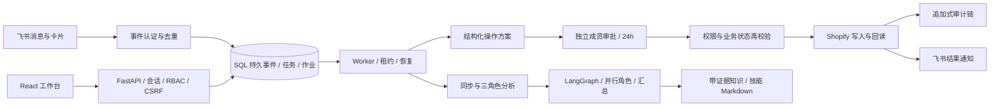

# 小跨 · 全链路 AI 运营官研究原型

一个把运营目标变成可追踪任务、把经验变成可复用技能的 AI Agent 参考实现。工作台连接飞书与 Shopify，围绕**消息 → 持久任务 → 操作方案 → 独立审批 → 执行 → 回读 → 审计**构建闭环。

**用途：技术研究、教学、二次开发。** 默认提供无需账号、密钥或外部网络调用的离线演示。公开版本包含真实平台适配代码，但不包含任何实际账户的凭据、订单、成员资料或平台截图。Amazon、Meta Ads、采购支付为后续扩展方向。

[完整测试报告与流程截图](docs/TEST_REPORT.md) · [真实平台接入](docs/INTEGRATIONS.md) · [架构与设计取舍](docs/RESEARCH.md) · [隐私发布说明](docs/PRIVACY.md) · [MIT 许可证](LICENSE)


## 已实现的闭环

| 能力 | 当前实现 | 研究边界 |
| --- | --- | --- |
| 办公入口 | 飞书消息、现代卡片批准/拒绝、任务结果通知；官方 SDK 长连接或签名加密 HTTPS 回调 | 演示台替代真实飞书消息投递；真实接入需自己的自建应用 |
| 订单与商品 | Shopify 订单/规格同步、库存比较并设置、纯文本商品说明更新 | 默认只允许测试订单与带 `xiaokua-test` 标签的商品写入 |
| 订单处理 | 履约、物流信息更新、取消、原交易退款 | 取消不自动退款；未接入承运商轨迹；Checkout 网关未纳入本次验收 |
| 人工审批 | 操作前后差异、独立成员审批、24 小时有效期、执行前再校验 | 所有业务写入需审批，包括小额退款；没有自动消费额度或真实 AI 钱包 |
| 持久任务 | SQL 队列、租约、心跳、进程恢复、事件去重、只读任务重试 | 外部写入结果未知时转人工核实，禁止盲目重发 |
| 多角色分析 | LangGraph 汇总订单、库存、客服知识三个角色的并行分析 | 没有生产记录或广告平台时，不推断制造根因或暂停真实广告 |
| 经验沉淀 | CSV/JSON 客服记录导入、按市场/主题生成带证据的技能草稿、人工启用、Markdown 导出 | 规则识别需至少 5 条同类记录；不是对所有语言/主题的通用自动学习 |
| 权限与审计 | 组织隔离、负责人/审批人/运营/只读角色、会话与 CSRF、凭据加密、追加式哈希审计链 | 数据库管理员仍有系统级控制；哈希链不是外部公证或合规认证 |
| 部署参考 | SQLite 本机模式、PostgreSQL、非 root Docker、HTTPS/备份示例 | 未进行公网、商店分发、容量或商业 SaaS 验收 |

## 快速开始：离线研究演示

需要 Python 3.11–3.13、[uv](https://docs.astral.sh/uv/getting-started/installation/) 与 Node.js 22。首次安装依赖需访问包源；启动后的演示不调用模型、Shopify 或飞书 API。

```bash
git clone https://github.com/LyzJames/xiaokua-ai-operations-agent.git
cd xiaokua-ai-operations-agent
uv sync --frozen
cd frontend
npm ci
npm run build
cd ..
uv run python -m backend.demo
```

Windows PowerShell、macOS 和 Linux 均使用上面的逐行命令。打开 **http://127.0.0.1:8003**。

| 合成账号 | 角色 | 演示密码 |
| --- | --- | --- |
| `owner@example.invalid` | 负责人、提出业务方案 | `demo-only-local-123` |
| `approver@example.invalid` | 独立审批人 | `demo-only-local-123` |
| `operator@example.invalid` | 运营人员 | `demo-only-local-123` |

这些账号和密码是公开演示常量。演示入口只监听 `127.0.0.1`，不可作为公开服务器的登录方案。

演示数据库与合成店铺状态位于 `data/research_demo/`。重启保留任务、库存和审计。要重新开始，使用一个新目录，避免覆盖已有数据：

```bash
uv run python -m backend.demo --data-dir data/my-fresh-demo --port 8003
```

演示入口拒绝复用没有演示标记的已有数据库，并阻止真实平台授权、凭据导入及外部回调。前端页顶明确标注合成数据。飞书事件模拟台在 **http://127.0.0.1:8003/demo/feishu**，登录工作台后打开；两个页面共享当前成员会话。

## 按这个顺序体验完整流程

1. 用负责人登录，打开飞书事件模拟台，发送“小跨，同步昨晚的欧洲订单与库存”。点击“刷新消息”，看到任务接收和完成通知；工作台出现 2 笔合成订单、1 个商品规格。
2. 在“商品与库存”申请把库存从 10 改为 15。在“审批中心”审查差异；申请人不能批准自己的方案。
3. 退出负责人账号，用审批人登录，再刷新模拟台。点击库存卡片的“批准”，点击商品“同步”后工作台回读库存为 15。重复点击同一卡片不会再次执行。
4. 再用负责人提出商品说明更新，由审批人“拒绝”；商品内容保持原值。订单页面还可以体验 0.50 USD 合成退款、履约、物流更新与取消，分别审批。
5. 在“记忆与技能”导入 [合成客服 CSV](examples/support-synthetic.csv)，点击“学习并生成草稿”。德国能效和法国本地退货形成未启用草稿；核对证据后启用，可下载 Markdown 技能文件。
6. 发送“分析德国客户的能效咨询”。三个角色依据已同步数据与已启用知识生成报告；德国问题不会引用法国的退货草稿。
7. 在“审计日志”查看审批、执行、回读和技能启用记录，检查哈希链并导出 CSV。在“运行设置”查看队列和任务状态。

逐步截图、具体断言、失败路径与真实平台验收范围见 [测试报告](docs/TEST_REPORT.md)。

## 架构



0.2 主入口由 SQL 持久化业务状态和任务队列；LangGraph 组织分析图，三个角色在受控线程池内并行。没有额外依赖 CrewAI 或 ContextDB：在这个范围内，角色职责、事务审批和关系库知识更容易复现。`backend/engine.py` 是 0.1 的独立模拟研究模块，包含 LangGraph checkpoint 示例，不是 0.2 平台写入队列。

离线模式通过依赖注入把 Shopify 换成持久化 `DemoShop`，把飞书发送换成本地 outbox；业务审批和 worker 使用同一套代码。分析固定使用清楚标记的规则模式。真实模式可以使用 DeepSeek 的 OpenAI 兼容 Chat Completions，模型不可用时报告标记为规则回退。`DEEPSEEK_MODEL` 应填写你的服务商实际开放的模型标识。

## 自己连接真实开发账号（可选）

先完成离线演示，再参考 [接入文档](docs/INTEGRATIONS.md)。真实入口与演示入口分开：

```bash
# 将 .env.example 复制为 .env，并填入你自己的配置；不要提交 .env。
uv run python -m uvicorn backend.service:app --host 127.0.0.1 --port 8000 --no-access-log
```

首次本机访问会显示初始设置流程。负责人创建组织，邀请另一成员承担独立审批；在“平台连接”完成 Shopify OAuth 与飞书连接。Webhook/OAuth 回调需满足平台的公网 HTTPS 配置要求，飞书消息也可使用官方 SDK 长连接。

```bash
uv run python -m backend.production.feishu_ws --connection-id YOUR_FEISHU_CONNECTION_ID
```

保持 `SHOPIFY_TEST_ONLY=true`。真实平台仅允许你自行授权的开发店铺和测试资源；**离线 demo 的成功不等于平台已授权或真实 API 已验收**。公开仓库不附带可用的 API key。研究者自行接入模型会发生服务商计费。

## 测试与复现

```bash
uv run pytest -q
uv run python scripts/demo_acceptance.py
cd frontend
npm run build
```

本次本机结果：**77 passed、4 skipped**；这 4 项为未选择 PostgreSQL 运行时的测试。另用一次性真实 PostgreSQL 运行后 **4 passed**，合计 81 个不同测试通过。完整离线业务验收由 `scripts/demo_acceptance.py` 输出断言结果，使用临时合成数据库，不读入平台凭据。

PostgreSQL 测试可选（需要 Docker，使用任务专属的临时数据库）：

```bash
uv run python scripts/start_test_postgres.py
uv run python scripts/run_postgres_tests.py
docker stop xiaokua-postgres-test
```

CI 包含离线后端测试、PostgreSQL 测试、演示业务验收、前端构建和公开文件检查，均不需要真实平台 secret。测试报告明确区分本次可复现的合成流程与此前真实开发平台的验收摘要。

## 目录导航

```text
backend/demo.py              无凭据、只监听本机的演示入口
backend/demo_shop.py         持久化合成店铺适配器
backend/production/api.py    工作台、权限、连接、隐私请求接口
backend/production/workflows.py  提案、审批、执行、知识与三角色分析
backend/production/worker.py SQL 队列、租约、事件及恢复
backend/production/shopify.py    GraphQL Admin API 适配器
backend/production/feishu*.py    消息、卡片、认证与官方 SDK 长连接
frontend/src/production.tsx React 0.2 工作台
frontend/demo/              明确标注合成数据的事件模拟台
examples/                   仅含合成的研究输入
scripts/                    演示验收、发布检查、备份与部署参考
tests/                      自动化测试
migrations/                 数据库迁移
docs/images/                本次重新拍摄的合成流程截图
deploy/                     自行研究部署时的通用模板
```

## 常见问题

- **页面提示“请先构建前端”？** 在 `frontend` 执行 `npm ci` 与 `npm run build`，再刷新页面。
- **消息发出后没有结果？** Worker 异步处理；稍后点击“刷新消息”和工作台“刷新数据”。查看“运行设置”中作业状态。
- **审批按钮不可用？** 确认当前账号是独立审批人，并且申请未过期。演示台与工作台共享同一个登录会话，切换成员后刷新模拟台。
- **技能草稿没有生成？** 每个市场/主题至少需要 5 条记录；同标题草稿重复学习不会重复创建。导入示例 CSV 可复现。
- **是否已经能作为商业 SaaS？** 这里交付研究原型和接入代码；平台商店分发、法律审查、生产容量、真实采购支付及公网试运营均不在交付范围。

## 隐私与贡献

请只用合成数据提交 Issue、截图与 PR。不要上传 `.env`、`Key.txt`、数据库、会话、备份或实际平台导出。发布扫描脚本是辅助检查，不能替代对新增图片和业务数据的人工审查。详见 [隐私说明](docs/PRIVACY.md)。

欢迎通过 GitHub Issue 和 PR 讨论研究改进。修改业务执行流程时，请保留独立审批、执行前校验和结果未知时停止自动重试的约束。

## 许可证

[MIT](LICENSE)。允许修改、再分发和商业使用，须保留版权与许可声明。第三方库、平台 API 和账号使用仍受各自条款约束。
