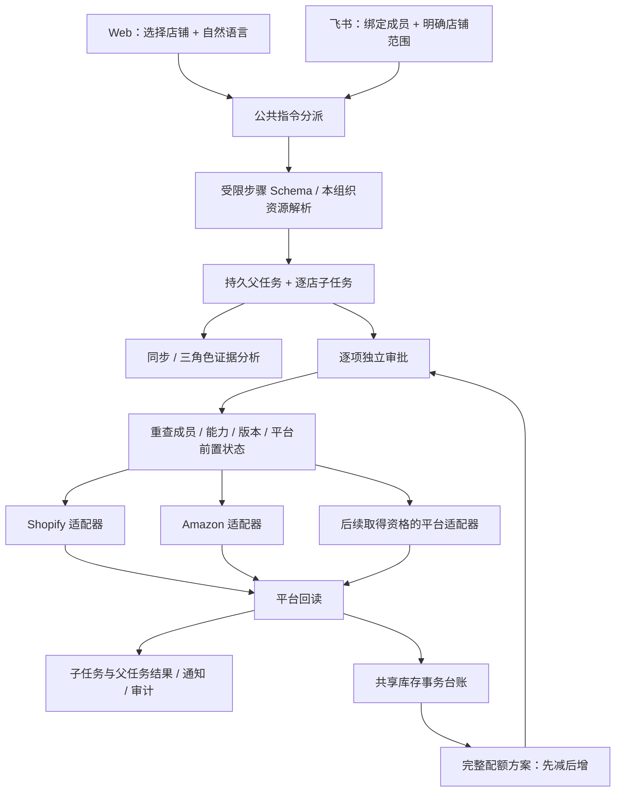

# 多平台指挥与共享库存架构

版本 0.4。小跨是独立 Web 应用；飞书是同一服务的办公入口。界面、身份、审批、队列、库存池和审计不依赖飞书才能运行。

## 公共契约

`backend/production/platforms/contracts.py` 定义 `OrderSnapshot`、`OrderLine`、`ProductSnapshot`、`InventoryLocation` 和 `CommerceAdapter`。保留原平台资源标识，所属组织与连接由服务端确定，跨店同 SKU 不自动合并。

适配器声明实际可执行能力，负责读取、操作前置检查、单次写入和只读核实。`inventory_position` 返回库存地点、数量和仓库类型，库存池无需解析各平台专属库存响应。未知金额、付款状态、明细数量或分页完整性明确标为未知，不能按零值推断业务事实。平台负可售库存保留原值并冻结增量。

Shopify 原始业务字段为已有用户案例和维护工具保留，分析及 Web 展示使用公共快照。后续适配器存储严格校验的公共快照，不能将任意平台响应直接交给模型。

注册入口位于 `platforms/registry.py` 的 `ADAPTER_BUILDERS`；平台目录声明接入阶段、认证类型和能力。当前仅注册 Shopify、Amazon 的实际适配器，没有未实现平台的占位目录或能力声明。Amazon 联通和扩展步骤见 [平台目录 README](../backend/production/platforms/README.md)。

## 指令与执行边界

- Web 必须选择 1–20 家本组织有效店铺；飞书使用店铺标签或“所有店铺”，多店对象不唯一时先澄清。
- 常用明确指令使用规则解析；复杂指令由配置的模型生成最多 8 步的受限 JSON，随后校验 Schema、资源归属与用户明确给出的金额、数量、说明和物流参数。模型无任意 URL、SQL、GraphQL、浏览器或支付执行权限。
- 同店步骤按依赖顺序执行，各店有独立子任务。父任务展示全部成功、等待审批、部分完成或需要核实，保留成功结果。
- 每个外部写入独立审批；执行前重新检查成员权限、连接状态、平台能力与前置状态。接口未知参数和伪造内部字段会被拒绝。
- 外部写入只发送一次。超时、进程中断、成功应答后回读失败或目标不吻合，均进入待核实，不能自动重发。状态吻合的核实并不自动证明是谁造成了状态变化；退款备注和唯一 MCF 编号可提供更具体的平台依据。

## 库存与数据库

共享台账、映射、订单明细位置、追加式库存日志和配额方案均按组织隔离。事务先锁组织再锁库存池，订单指纹与平台更新时间用于去重和忽略旧快照。待发货订单预留，已知发货差量扣实物，取消释放，退款不自动补实物。

配额合计受可分配量约束；减少步骤都成功并回读后，增加步骤才可生成审批。关联源不完整、未知写入、过期审批、旧池版本或已解除连接会停止增量。各平台没有共同数据库事务，所以保留部分成功并人工处理，不承诺跨平台零超卖或一起回滚。

PostgreSQL Worker 按单条候选作业使用 `FOR UPDATE SKIP LOCKED`，避免批量锁住队列导致其他 Worker 无作业可领。租约和心跳用于重启恢复，任务、角色报告和审计均落 SQL。SQLite 用于本机研究；试运营采用 PostgreSQL。库存日志和审计日志的更新、删除由数据库触发器阻止。

## 增加一个真实平台

1. 取得平台认可的开发资格、商户授权、权限范围与区域文档；明确订单窗口、库存语义、限流、幂等和错误结果。
2. 实现固定官方端点的认证、公共快照、能力声明、前置检查、单次写入和回读适配器，处理分页与资料缺失；以可确认的数据维护 `lines_complete` 与 `locations_complete`。
3. 注册 builder 与平台能力目录，增加负责人凭据/OAuth 接入和连接撤销处理。认证凭据加密，组织身份不能由模型参数决定。
4. 运行公共契约、组织隔离、库存联动与故障测试，再用该平台真实测试资格验收全部业务状态。未经真实验收的能力继续关闭。

框架选择保留 LangGraph 并行角色与 SQL 持久任务；当前需求不额外引入 CrewAI 调度器或付费记忆云。技能仍以带证据的本地 SQL/Markdown 管理，模型上下文按需加载，避免多套编排同时争夺写入与恢复责任。

官方依据：[Shopify 库存 CAS](https://shopify.dev/docs/api/admin-graphql/2026-10/mutations/inventorySetQuantities)、[Amazon Orders](https://developer-docs.amazon.com/sp-api/docs/orders-api)、[Amazon MCF 新版模型](https://github.com/amzn/selling-partner-api-models/blob/main/models/fulfillment-outbound-api-model/fulfillmentOutbound_2026-07-04.json)、[Amazon 动态沙箱](https://developer-docs.amazon.com/sp-api/docs/fulfillment-outbound-dynamic-sandbox-guide)、[AWS Saga](https://docs.aws.amazon.com/prescriptive-guidance/latest/cloud-design-patterns/saga-orchestration.html)。
