# 多平台完整流程验收

版本 0.4，日期 2026-10-13（北京时间）。原有三个买家前台下单案例保留在 [用户案例](USER_JOURNEYS.md)，其真实平台验收日期为 2026-10-12。本页记录本轮多平台、Web 指挥和共享库存的新增完整流程。

## D：选择多店，到聚合任务结案

**目标：** Web 与飞书都能明确指挥多家店，任务与资料归属不会串店。

浏览器从两个隔离的合成 Shopify 店开始：负责人登录、同时勾选店铺、输入“同步并分析所选店铺”，系统生成每店同步与分析子任务，同步完成后分析，父任务聚合结案，报告可下载。飞书相同分派路径另有完整事件/Worker 测试：多店模糊指令先澄清，“所有店铺”生成相同依赖任务。

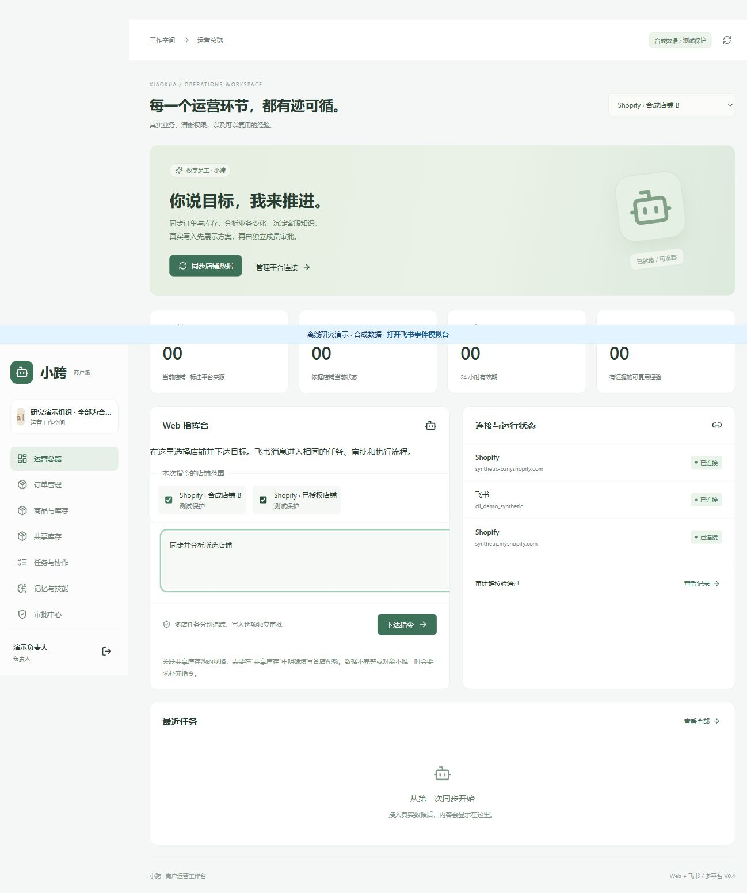

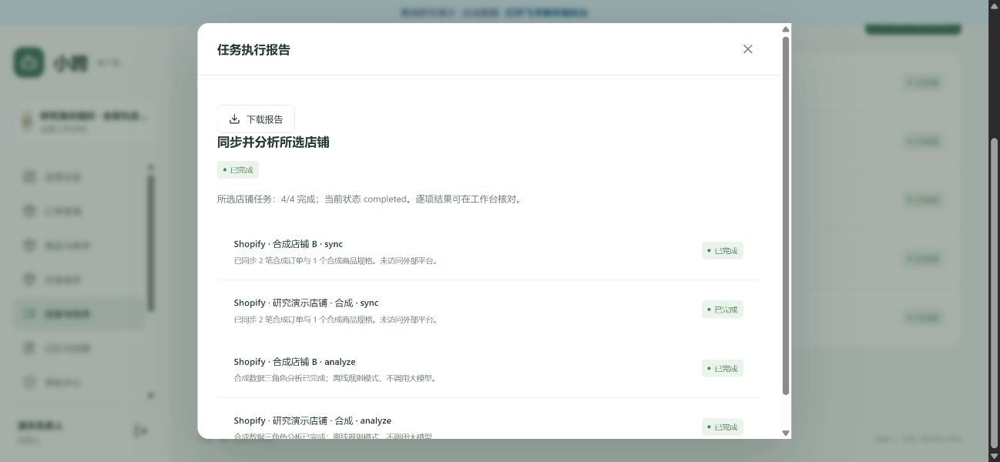

另用自己的真实 Shopify 开发店、Amazon LWA 沙箱与配置的模型执行同一 `/api/commands` 链路：两店同步、各三角色分析、结构与证据校验、结果聚合与审计通过。Shopify 来自真实开发店读取；Amazon Orders 来自所在区域官方固定样例；FBA 来自动态沙箱。这个账户链路使用 HTTP 测试客户端驱动应用，不冒充 Chrome 中 Amazon 商家订单页。

证据：[真实账户脱敏记录](commerce-live-acceptance.json)。自然语言两店独立写入的完整接口测试还验证了：一店批准只改变该店，第二店仍等待审批；两店分别批准后结案；同一幂等键不会重复建立父任务，重复执行不会再发送。

## E：盘点、预留、配额分配，到两店回读

**目标：** 一个物理仓的商品供给两家店，共享数量有明确依据，先减后增且各自审批。

本轮浏览器全程在离线合成环境执行正式业务代码。先创建欧洲仓/主 SKU，明确映射两个店的规格和地点，申请实物盘点 40 件。申请人界面无法自批，切换另一角色批准后，系统从两店共 4 笔待发货订单预留 4 件；安全库存 5，可分配量为 31。

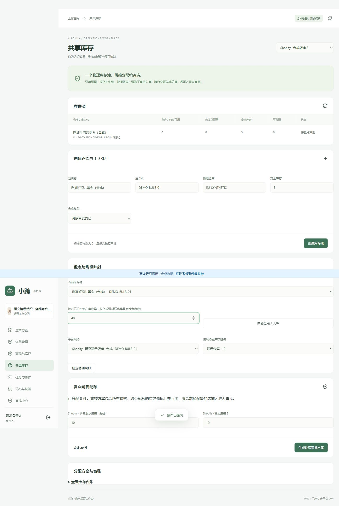

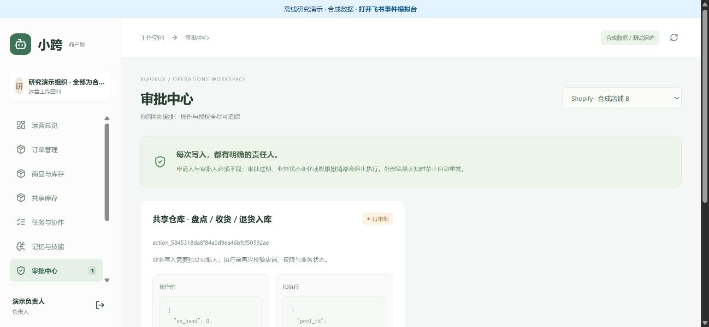

随后由另一角色提出完整配额：店铺 A 从 10 到 14，店铺 B 从 10 到 6，总配额 20。系统首先只生成 B 的减库存申请；另一成员批准后执行并回读为 6，才生成 A 的增库存申请。两次独立批准完成后，平台快照为 14/6，方案完成，池在库与预留保持 40/4。

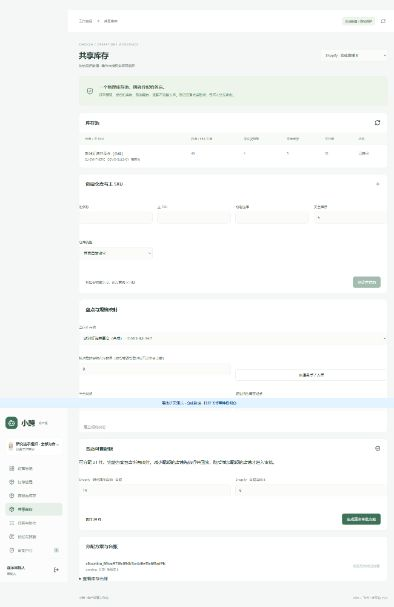

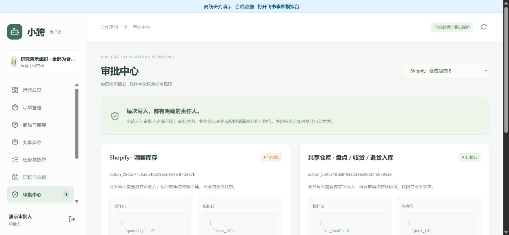

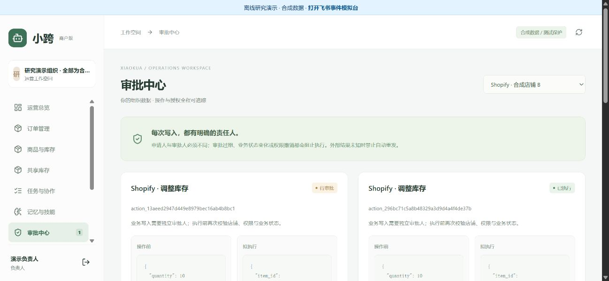

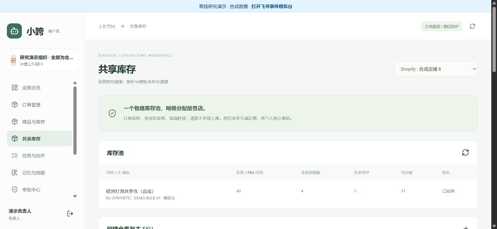

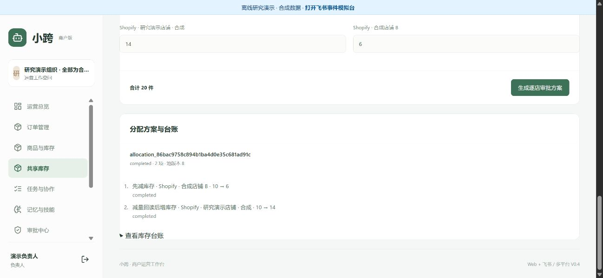

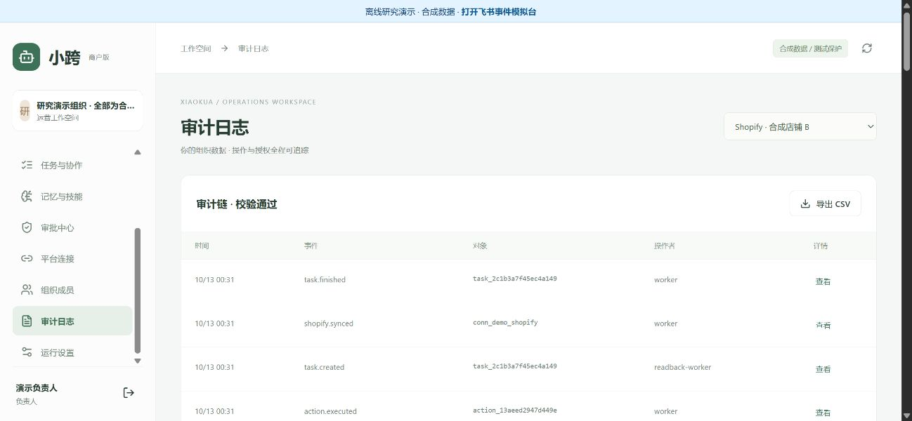

这条图形界面流程验证的是正式代码在合成店铺上的行为；未声称两家真实 Shopify 店铺都已授权。真实开发店另验证了库存比较并设置、审批与平台回读，目标保持原值，没有净库存变化；也通过真实凭据读取验证了库存池映射，见 [映射检查](commerce-mapping-check.json)。该检查只配置本机验收池，没有声称实际仓库盘点或改变外部数量。数据库测试还覆盖重复/并发观察、已知发货只扣一次、退款不入库、取消释放、未知减量/回读不符阻止增量、过期审批冻结，以及 FBA 独立只读池。

## F：Amazon 虚拟 SKU，到履约、虚拟交付、取消及库存核对

**目标：** 新开发者不用真实商品、付款或包裹，也能验证平台认证与可变化业务状态。

使用用户自己的 Amazon SP-API 沙箱凭据，正式适配器与审批/Worker 路径顺序完成：

1. LWA 认证、所在区域 Orders 官方静态样例读取、FBA 动态库存同步。
2. 创建唯一测试 SKU，添加 10 件虚拟库存，分别经过两种成员身份的申请与批准。
3. 创建数量 2 的 MCF，平台回读；批准推进 `COMPLETE`。
4. 从平台读取真实沙箱包裹编号，分别批准 `OUT_FOR_DELIVERY` 和 `DELIVERED`，每次回读包裹状态。
5. 再创建数量 1 的 MCF，独立批准取消，回读 `CANCELLED`。
6. FBA 可售库存最终为 8，符合完成 2 件、取消释放 1 件后的目标；审计链及公开状态的凭据/买家身份检查通过。

订单采用 Orders `2026-01-01`，MCF 采用 Fulfillment Outbound `2026-07-04`。每项虚拟写入都经过独立测试成员审批，审批成员由脚本创建为合成身份；这验证权限流程，不等于两个自然人的人工审查。虚拟交付没有发生真实快递运输。

平台本次仍返回预留数量 2，公开记录保留该读数；可售数和订单/包裹目标已吻合，不据此声称预留已清零，也不将该字段映射为商家仓实物库存。生产环境需要以实际平台数据和通知继续验证这一边界。

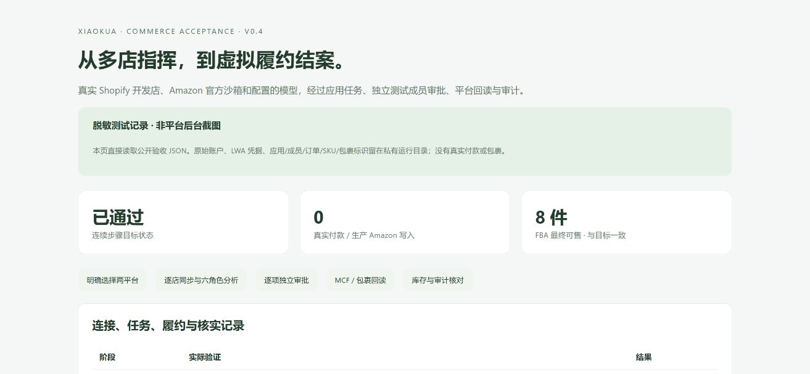

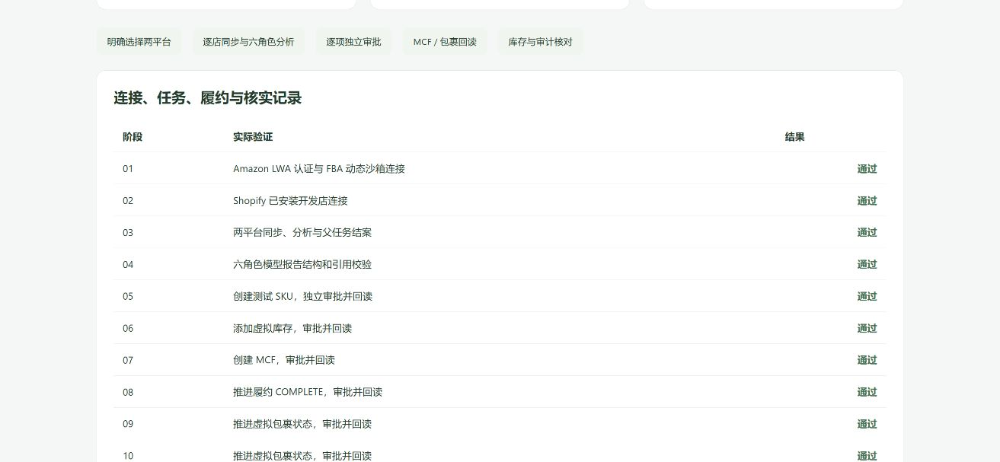

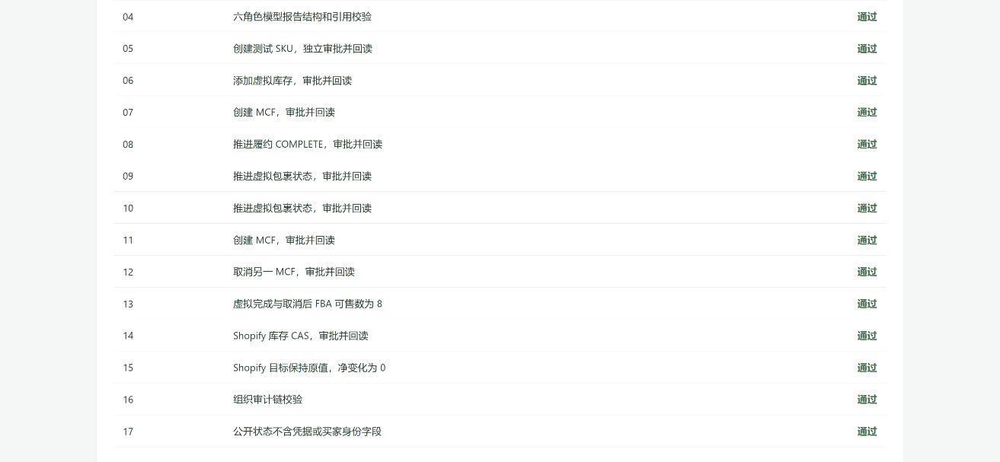

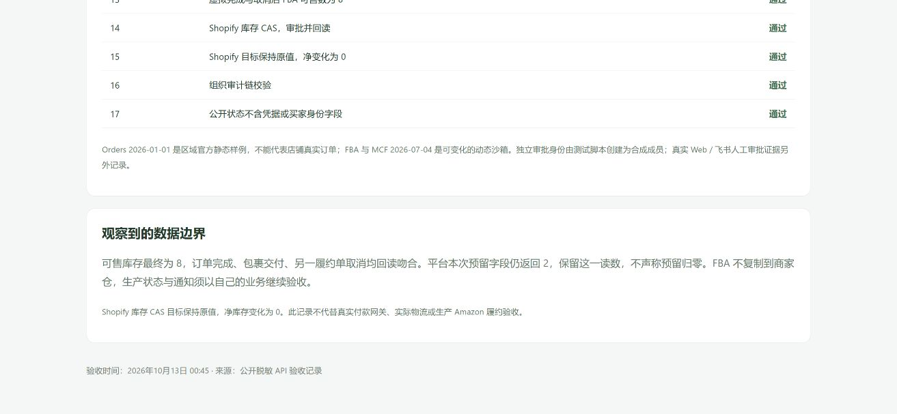

[脱敏机器记录](commerce-live-acceptance.json)保留每一步状态和合成数量，不包含 LWA 凭据、应用/成员/订单/SKU 标识。Amazon 官方说明沙箱订单不能在 Seller Central 查看；因此使用 API 回读证明状态，而不是伪造商家后台画面。

复现：在自己的私有配置中填 Shopify、Amazon、模型信息，保持测试保护，再运行：

```bash
uv run python scripts/commerce_acceptance.py --live-sandbox --model --shopify-test-write --report data/my-commerce-acceptance.json
```

该命令明确调用真实账号 API，Amazon 写入仅指向动态沙箱，Shopify 写入仅选带测试标签的开发商品且目标保持原数量。脚本创建独立本机测试数据库与成员；不会替代组织实际成员审批验收，原始运行数据只留在忽略的 `data/`。

## 尚未取得资格的平台

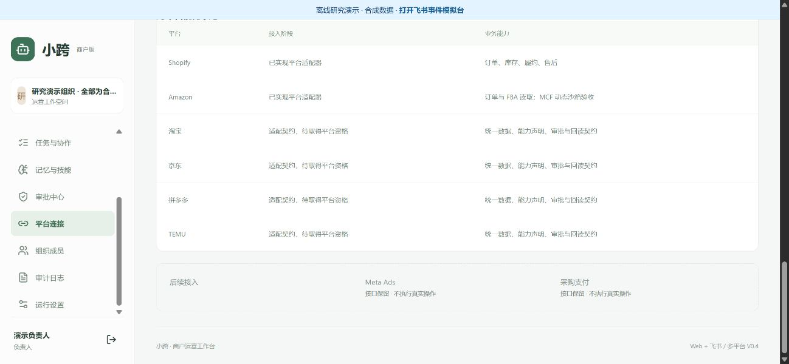

淘宝、京东、拼多多、TEMU 没有真实账号联调。每个平台均验证了公共快照、注入合成适配器、独立审批、单次执行和核实契约；缺少已注册适配器时，平台能力为空且不能获得访问。具体签名、店铺认证、商品与订单业务语义须在取得资格后实现，扩展步骤见 [架构说明](COMMERCE_ARCHITECTURE.md)。

官方依据：[Amazon 静态/动态沙箱](https://developer-docs.amazon.com/sp-api/docs/sp-api-sandbox)、[MCF 动态沙箱与 Seller Central 可见性](https://developer-docs.amazon.com/sp-api/docs/fulfillment-outbound-dynamic-sandbox-guide)、[新版包裹更新](https://developer-docs.amazon.com/sp-api/reference/updatepackage-1)、[Shopify 库存 CAS](https://shopify.dev/docs/api/admin-graphql/2026-10/mutations/inventorySetQuantities)。
