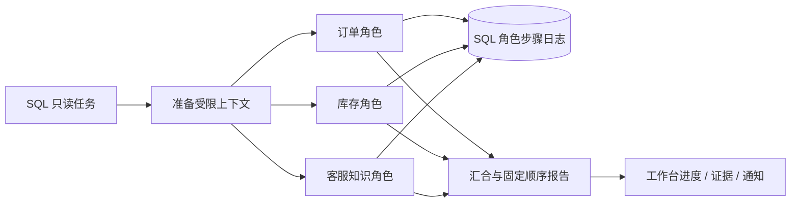

# 架构与研究边界

此原型研究飞书数字员工如何连接 Shopify、沉淀知识并在可审查授权下执行业务。0.3 的优化依据与官方资料见 [技术调研](TECH_REVIEW.md)。

## 状态与权限

SQL 业务状态由 events、tasks、actions、jobs、resources、knowledge、audits 管理。写入需要先保存方案及快照，再由不同成员审批，执行前复核权限与平台状态，最后回读并审计。资金测试保护和结果未知时停止重发的约束位于业务代码，模型不能改变。

外部写入未知时进入人工核实，不能以队列恢复或模型建议为重发许可。审计链能检查应用记录的连续性，不能替代外部公证或法律合规认证。

## 原生图与角色步骤日志

三个角色是 LangGraph 独立节点，由 reducer 合并各自结果。模型只返回受检的只读结论。订单、库存和客服上下文分别构造，不向所有角色发送整份知识库。

`analysis_steps` 用组织、任务、角色隔离步骤，保存输入指纹、状态和输出。同一任务恢复可以复用输入未变的成功角色；知识禁用、数据和模型格式变化会使对应指纹失效。模型回退结果会重新尝试。SQLite 与 PostgreSQL 使用相同语义，并有原生并行、部分中断、重建数据库连接与复用测试。

它不是 LangGraph checkpointer，不会冻结整张图或保证模型请求恰好一次。重试重新获取当前同步快照；若进程在保存回答前退出，模型可能再次被调用。历史 0.1 模块保留独立 checkpoint 示例，不能与当前 Shopify 写入队列混为一条链。

## 记忆、技能与模型

客服记录按市场和主题规则生成带证据草稿，至少五条记录、默认未启用。检索先选元信息，再加载匹配正文，最多四条，每条最多 1600 字符；同地区的不同主题也需要匹配。当前不是通用向量语义检索。

技能导出符合 Agent Skills 目录与元信息要求，可下载单个 SKILL.md 或包含 references/evidence.md 的 ZIP。内容仅作为资料，没有任意脚本执行或额外写入权限。

模型稳定 JSON 与可选 Beta strict 两条路径均做本地 Schema 与引用校验；有证据却不引用、引用外部标识、返回额外操作字段等情况进入明确的规则回退。引用校验不保证自然语言真实性，人工仍需核对政策和结论。

## 复现与限制

完整平台复现使用研究者自己的飞书、Shopify 和模型账号；离线演示通过实例依赖注入替换平台与模型，复用正式权限、队列、审批、执行和审计代码。

五类验收与截图见 [测试报告](TEST_REPORT.md)。本轮真实连接检查只覆盖只读访问和合成模型输入，消息/卡片与业务写入的此前验收摘要单独标注。没有宣称完成公网服务、容量、所有模型质量或商业 SaaS 验收。

Amazon、Meta、真实采购支付、独立跨服务 Agent 协作、更多主题和语义检索属于后续研究。增加框架或协议应服务于明确需求，并保留现有审批、数据边界和未知结果处理。
