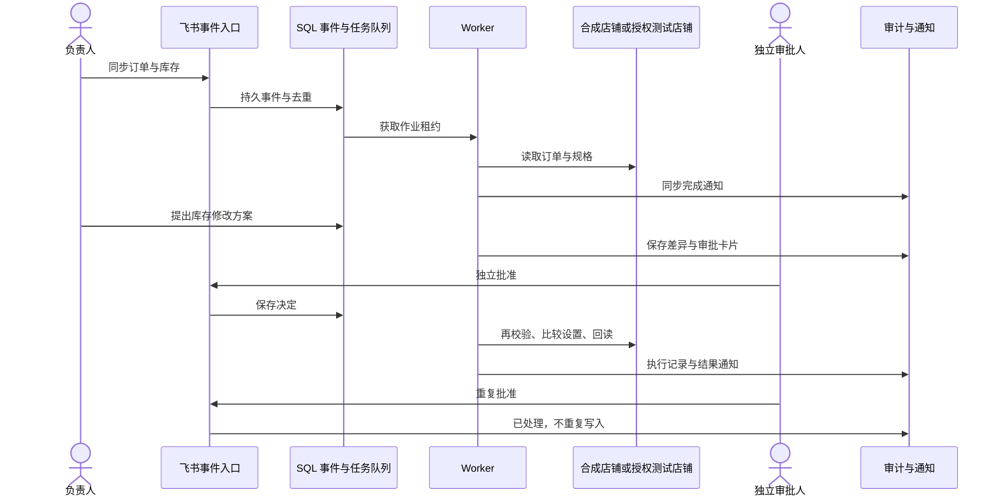
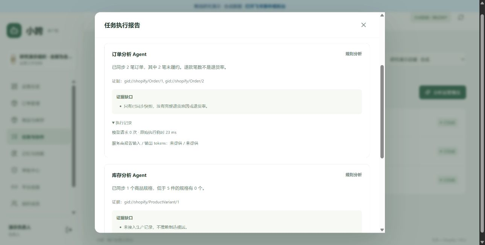

# 小跨研究原型 · 分类测试报告与完整流程截图

本报告覆盖 0.3 参考原型，验收日期为 2026-10-12（北京时间）。按业务能力归纳测试，结合浏览器流程、自动化断言和有限的真实账号只读检查，分别说明证据范围。

公开图片全部来自合成环境：合成账号、订单、客服案例与本地飞书消息适配器。0.3 改动涉及的导入、技能、分析与通知画面重新拍摄；未变化的审批、订单、审计流程保留已审查的 0.2 基线截图。画面不调用真实平台或模型，没有真实支付。并行、去重、权限和重启恢复由自动化验证，截图只展示交互过程。

## 五类验收结论

| 类别 | 本轮验证重点 | 结果与证据 |
| --- | --- | --- |
| 业务闭环 | 消息触发、同步、库存、商品说明、履约、物流、取消、测试退款 | 通过；下方业务流程 + [合成验收记录](demo-acceptance.json) |
| 权限与安全 | 会话、CSRF、组织隔离、独立审批、测试保护、去重与审计 | 通过；分类回归与拒绝路径 |
| Agent 分析 | 原生并行、上下文隔离、结构校验、引用校验、短暂故障重试、显式回退 | 通过；分析界面 + 模型协议测试 |
| 记忆与技能 | 实际 CSV 导入、证据草稿、市场/主题匹配、按需加载、标准技能包 | 通过；技能界面 + HTTP/ZIP 验证 |
| 恢复与发布 | SQL 任务和角色恢复、实际 PostgreSQL 并发、前端构建、公开文件审查 | 通过；分类回归、发布扫描与逐图审查 |

[分类机器记录](test-categories.json)只保留类别和汇总状态，不记录用例参数、异常正文、凭据或本机路径。完整回归包含 SQLite 与一次性 PostgreSQL，未省略数据库类别。第三方 SDK 有弃用提示，不影响本轮结果。

环境：Windows、Python 3.13.7、Node.js 24.9.0、npm 11.6.0、Chrome、本机 Docker PostgreSQL。GitHub Actions 使用 Ubuntu、Python 3.13、Node.js 22 和 PostgreSQL 17，运行相同分类回归、合成闭环、前端构建与公开文件检查；最新状态见 [Actions](https://github.com/LyzJames/xiaokua-ai-operations-agent/actions/workflows/ci.yml)。

## 复现方式与证据关系

完整真实复现需要研究者自己的飞书应用、Shopify 开发店铺和模型 API Key，配置与账号步骤见 [接入指南](INTEGRATIONS.md)。无需密钥的离线流程用于验证业务逻辑；模型协议测试用模拟响应验证失败处理，真实模型检查只使用合成内容。首次安装依赖需要网络。

```bash
uv sync --frozen
uv run python scripts/start_test_postgres.py
uv run python scripts/run_postgres_tests.py --full --category-report data/test-categories.json
uv run python scripts/summarize_tests.py data/test-categories.json
uv run python scripts/demo_acceptance.py
cd frontend
npm ci
npm run build
cd ..
uv run python -m backend.demo
```

Docker 不可用时可运行 `uv run pytest -q --category-report data/test-categories.json`，报告会明确标注 PostgreSQL 未运行的类别。演示地址为 http://127.0.0.1:8003；账号见 [README](../README.md)。完整合成流程脚本使用独立临时数据库，并禁止向外部服务发出 HTTP 请求。本轮浏览器截图使用另一个合成目录与端口 8004，不涉及真实运行数据。



## 一、业务闭环

### 办公消息 → 持久任务 → 同步 → 完成通知

负责人在事件模拟台发送“小跨，同步昨晚的欧洲订单与库存”。模拟台使用正式事件接收、队列、Worker 和通知逻辑，仅把平台收发替换为本地适配器。


任务完成通知明确写出 2 笔合成订单、1 个合成规格，以及“未访问外部平台”。


订单页面回读得到 `#DEMO-0001` 和 `#DEMO-0002`，初始均为测试订单、已支付、未履约；不保存客户姓名、邮箱或地址。


### 库存方案 → 禁止自批 → 独立卡片批准 → 回读

负责人提出库存从 10 改为 15。提交方案不会修改店铺库存。


审批中心展示操作前后差异。申请人自己的批准按钮不可用；自动化也验证对应请求被拒绝，返回 422。


退出负责人账号，用独立审批人登录，再刷新事件模拟台，查看库存卡片。


批准后，Worker 进行状态校验、比较设置与回读。点击商品“同步”后，工作台库存为 15。


重复点击同一卡片得到“操作已处理”；完整流程脚本验证只有一次库存写入。


### 未确认商品说明 → 拒绝 → 不写入

负责人申请写入一段尚未核实的商品说明。这个流程验证审批人能拒绝方案，而不会把示例能效承诺写入商品。


审批人拒绝后，状态显示“已拒绝”，商品说明保持原值。自动化另外覆盖了获准纯文本说明被转义后写入的成功路径。


### 合成退款与履约 → 审批卡片 → 状态回读

对订单一申请退款 0.50 USD，对订单二申请履约，使用合成承运商和追踪号。两者均为人工审批方案。


独立审批人分别检查卡片并批准。没有调用支付服务；这里的金额只是 `DemoShop` 状态变化。


回读结果：订单一为 `PARTIALLY_REFUNDED`；订单二为 `FULFILLED`，追踪号为 `DEMO-TRACK-001`。


### 更新物流与取消 → 工作台独立审批 → 最终订单状态

物流更新引用已存在的履约 ID，把追踪号更新为 `DEMO-TRACK-002`。取消方案明确不自动退款。


审批人也可在工作台批准并填写说明，无须使用模拟卡片。


最终回读：订单一已取消且维持部分退款，累计退款仍为 0.50 USD、净额为 19.40 USD；订单二已履约并显示更新后的合成追踪号。完整脚本验证取消未增加退款。


## 二、权限与安全

### 登录与合成环境标识

登录页面和页顶持续标记“离线研究演示 / 合成数据”。演示入口只绑定回环地址；公开演示常量不能用于公开服务器认证。


负责人进入总览，连接使用明确的占位符。截图中的任务编号是本次演示随机编号。


### 审计与成员职责

审计页显示哈希链校验通过，并提供 CSV 导出。事件包括审批决定、执行、任务、技能生成与启用。哈希链用于检测现有记录完整性，不代表外部公证或法规认证。


三个成员均为合成账号。负责人提出方案，审批人独立决定，运营人员创建任务；角色分析结果不能授予平台写入权限。


### 拒绝与不重复执行路径

| 场景 | 验证行为 |
| --- | --- |
| 未登录 / 缺 CSRF | 拒绝读取成员 outbox / 拒绝模拟事件写入 |
| 演示模式导入真实配置 | 返回 403，不接入外部平台 |
| 申请人自批 / 跨组织访问 | 拒绝操作，库存和数据不变 |
| 重复卡片或事件 | 返回已处理，不重复平台写入 |
| 过期审批 / 角色变化 / 状态变化 | 拒绝越权与过期操作，写入前再次核对 |
| 网络结果未知 | 进入人工核实状态，不盲目重发退款或履约 |
| 商品说明方案拒绝 | 不写入；成功路径验证纯文本转义 |
| 未登录 / 跨组织导出技能 | 未登录返回 401，其他组织技能不可读取 |
| 非演示已有数据库 | 演示入口拒绝复用，原文件不改写 |

## 三、Agent 分析

### 三角色分析 → 市场检索隔离 → 办公通知

发起“分析德国客户的能效咨询”，订单、库存、客服知识在三个 LangGraph 原生节点中并行运行，独立保存结果，再汇总已同步数据。界面展示完成进度、模型请求次数与恢复复用数。报告明确使用离线规则模式，不调用大模型，不将退款笔数表述为退货率，也不推断未接入的制造根因。


德国查询只检索到一份德国能效知识；法国退货草稿不参与。市场隔离由完整流程脚本检查。报告支持 Markdown 导出。


从办公消息入口发起同类分析后，模拟台收到任务创建与三角色完成通知。


展开角色的执行记录，可看到请求次数、用时与服务商实际提供的 token 用量。离线角色不请求模型，用量标记“未提供”，不虚构成本。



### 并行、结构和恢复的自动化证据

三个角色通过并发屏障验证原生并行，各自只接收订单统计、库存统计或匹配知识。Pydantic 拒绝未知字段、错误类型、超长结果和伪造引用；越权退款字段不能转成操作方案。截断输出、鉴权错误和无效 JSON 明确回退，只有超时及短暂服务故障在预算内重试。

角色结果保存到 `analysis_steps`。测试让库存角色中断，关闭数据库连接后重建服务，再次运行同一任务，验证订单和知识角色复用成功结果，仅重新分析缺失部分。库存快照或技能启用状态改变，会使相应角色的输入指纹失效。PostgreSQL 也验证步骤保存、重开与复用。

这是应用层 SQL 步骤日志，不是 LangGraph checkpointer。模型已经响应但结果尚未保存时崩溃，恢复可能重复请求；引用属于允许范围也不等于自然语言结论已被证明。研究取舍见 [技术调研](TECH_REVIEW.md)。

## 四、记忆与技能

### 客服记录 → 带证据技能草稿 → 人工启用 → 导出

导入十条合成记录：德国能源效率咨询 5 条、法国本地退货咨询 5 条。本轮在 Chrome 的实际文件选择器中选择合成 CSV，界面确认成功导入；JSON 粘贴与 CSV 解析也由自动化覆盖。[示例 CSV](../examples/support-synthetic.csv) 可供复现。


点击“学习并生成草稿”，生成两份未启用技能，每份保留 5 条证据。内容要求检索已确认政策，不能凭咨询次数推断实际能效等级或本地退货资格。重复学习不会重复创建同标题草稿。


人工核对后启用，可下载带标准 frontmatter 的 `SKILL.md`，或包含技能目录和 `references/evidence.md` 的 ZIP 技能包。自动化解开实际 HTTP 响应，验证名称、正文、证据、租户权限和安全路径。浏览器下载事件仍未返回可确认的本机文件路径，因此不把文件已保存到 Chrome 下载目录当作验收证据。


检索先读取元信息，再按市场和主题加载最多四条正文，每条有长度上限。测试覆盖德国、法国、英国与其他市场，排除未启用或主题不符的政策，并验证重复学习不会重复生成同名草稿。

标准技能示例见 [SKILL.md](../examples/skills/de-energy-response/SKILL.md) 与 [引用证据](../examples/skills/de-energy-response/references/evidence.md)。示例全部合成，只提供可读资料，没有可执行脚本，不授予平台操作权限。

## 五、恢复与发布

### 持久作业、真实适配入口与后续接口

运行设置展示任务、业务写入和通知作业。合成流程在关闭旧实例后重建服务，验证排队任务恢复、库存状态持续存在和审计链有效；单张截图不能证明重启恢复。


### 真实适配入口与后续接口边界

平台连接页面保留 Shopify 与飞书接入入口，演示环境阻止真实凭据导入和平台回调。


组织连接只显示合成标识。Amazon、Meta Ads、采购支付明确为后续接口保留，不执行真实操作。


### 本轮真实账号只读检查

| 检查 | 结果 | 证据与限制 |
| --- | --- | --- |
| Shopify 已安装应用读取 | 通过 | 认证与店铺读取，不公开店铺标识 |
| Shopify 订单数据查询 | 通过 | 查询成功，不公开实际订单内容 |
| 飞书应用认证 | 通过 | 获取应用认证；不等于实际消息、卡片或身份绑定验收 |
| DeepSeek JSON 模式 | 通过 | 合成输入，输出通过结构与引用校验 |
| DeepSeek Beta strict tools | 通过 | 合成输入；仅作为结构化返回格式，不执行工具 |

只读检查摘要：[平台与默认模型](live-readonly-check.json)、[Beta 格式](live-strict-model-check.json)。本轮检查没有发送飞书消息、写入店铺或操作真实资金。连接通过不能替代真实业务全链路验收；模型检查也不是答案质量基准测试。

研究者可用自己的配置运行：

```bash
uv run python scripts/verify_integrations.py --platforms-readonly --model
```

### 历史平台基线与未验收范围

| 历史开发环境 | 已验证范围 | 公开证据限制 |
| --- | --- | --- |
| Shopify 开发店铺 | 订单/商品读取、测试库存/说明、小额测试退款、履约、物流、取消、去重与审计 | 原交易为测试交易；实际标识、平台截图和交易日志不公开 |
| 飞书自建应用与官方长连接 | 实际消息、批准/拒绝、重复操作、结果通知与重启 | 实际成员和平台截图不公开 |
| 本机 Docker + PostgreSQL + HTTPS 代理 | 容器运行、数据恢复、备份、任务持久与健康检查 | 未部署公网服务器 |

历史基线是此前执行的开发验收，不冒充本轮重新测试。Checkout 网关、应用商店分发、实际承运商轨迹、真实采购支付、公网试运营、容量与商业 SaaS 验收仍不在本原型范围内。

### 公开图片与文件审查

报告包含 33 张实际浏览器截图，均逐图查看，保留原图并在清单中记录 SHA-256。没有真实客户、联系人、店铺域名、App ID、成员 Open ID、后台账号页、API Key 或真实支付信息。金额、邮箱、连接标识与任务编号均来自显式合成数据。

发布从源码白名单生成独立目录，排除 `.env`、`Key.txt`、数据库、会话、密钥、旧平台截图、原始日志和打包文件。发布前检查公开文本、图片元数据、相对链接，并与私有凭据及账号标识进行精确比对；扫描不替代新增内容的人工审查。

图片清单见 [screenshot-manifest.json](screenshot-manifest.json)，文件哈希见 [public-manifest.json](public-manifest.json)，隐私规则见 [PRIVACY.md](PRIVACY.md)，许可见 [MIT](../LICENSE)。
