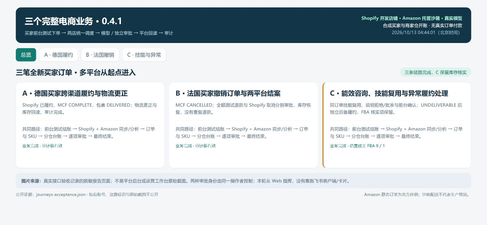
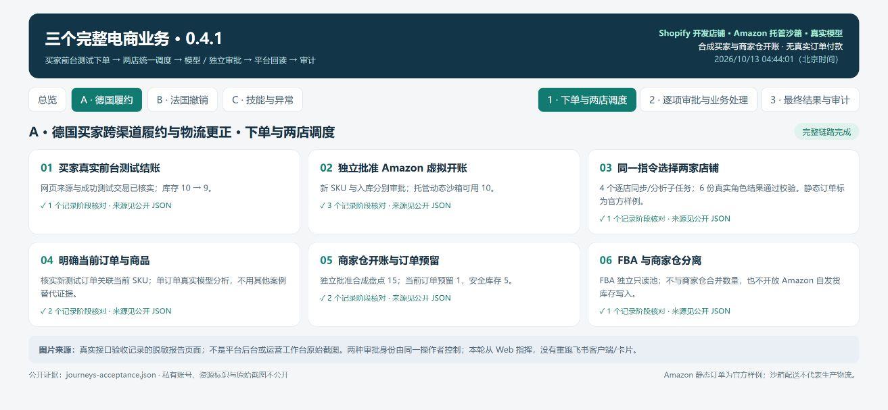
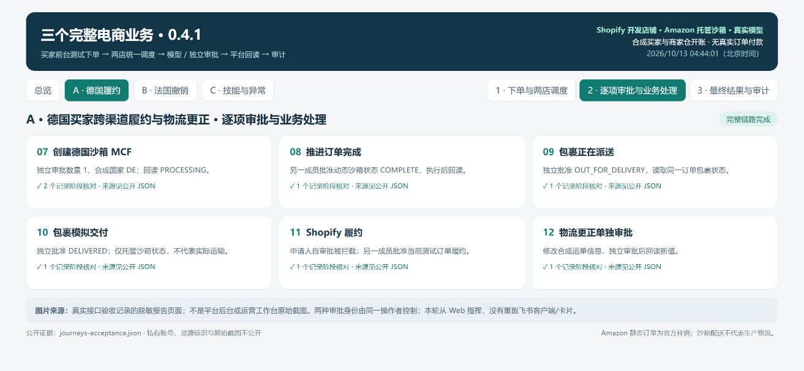
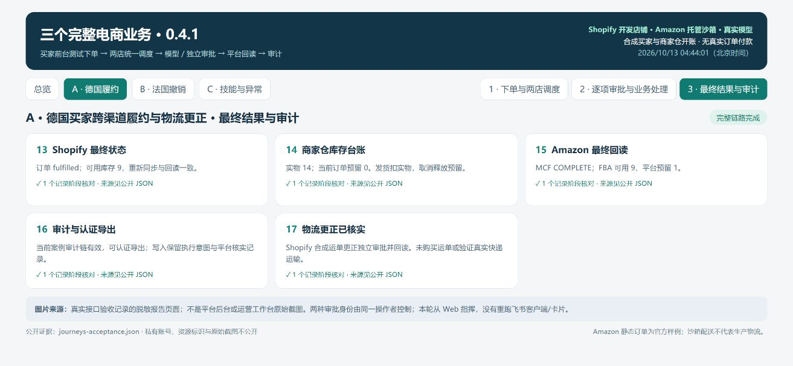
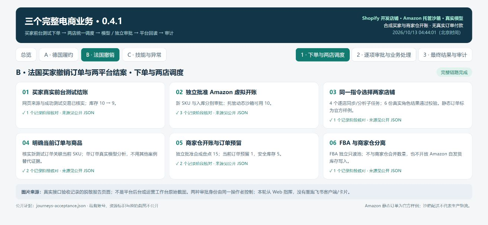
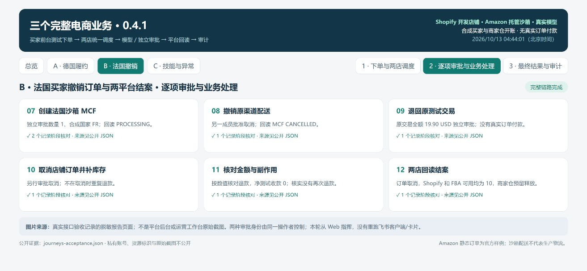
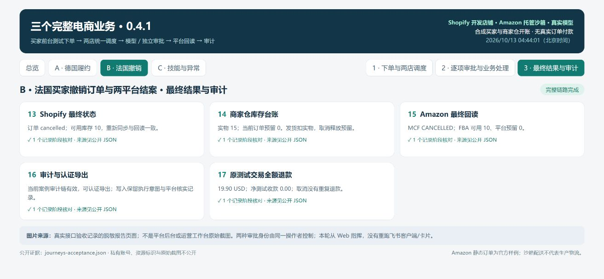
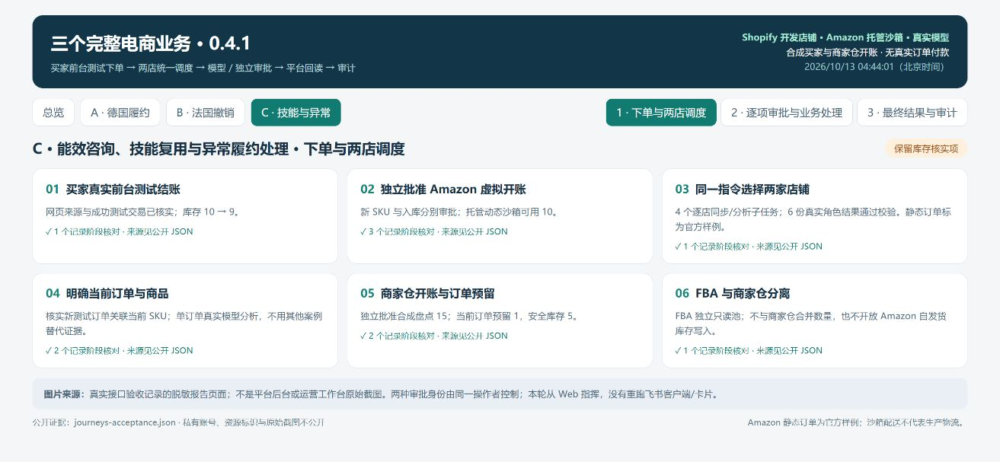
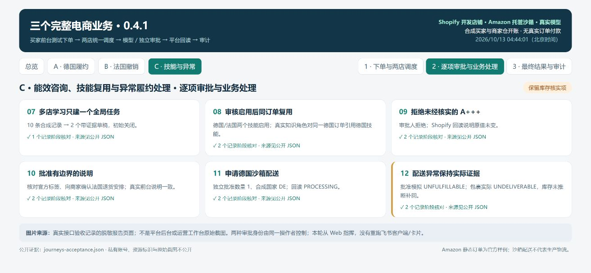
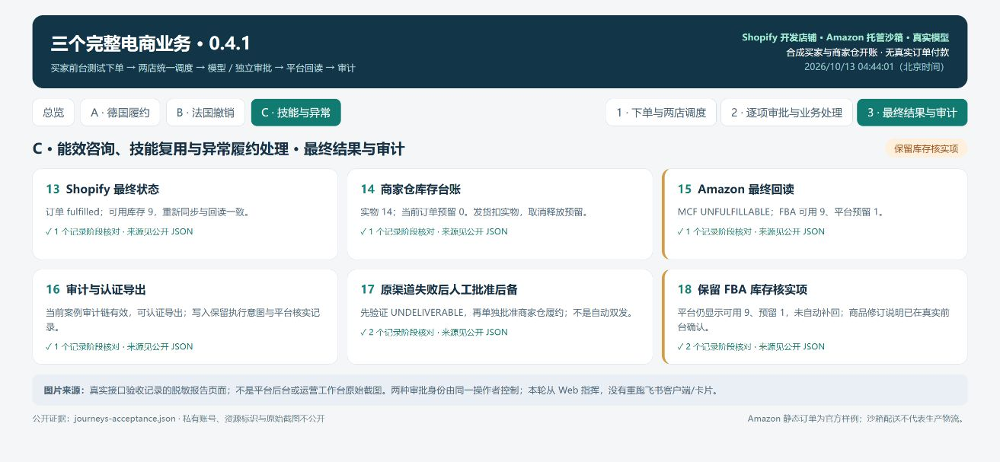

# 小跨 0.4.1 · 完整业务验收报告

验收日期：2026-10-13（Asia/Shanghai）。本轮重新创建三笔 Shopify 买家前台测试订单。每个案例从一开始就同时选择 Shopify 与 Amazon，使用真实应用的指令、持久任务、模型、独立审批、Worker、平台回读及审计流程，走到最终业务结果。

三个案例的流程均完成。案例 C 保留一项 **FBA 库存人工核实**：平台回读可用 9、预留 1，未自动补回或宣称预留释放。[完整复现步骤](USER_JOURNEYS.md)、[脱敏逐阶段记录](journeys-acceptance.json)、[交互报告页面](journey-evidence.html)。

## 使用了什么证据

| 环节 | 本轮实际来源 | 结论边界 |
| --- | --- | --- |
| 买家下单 | Chrome 中的真实 Shopify 开发店铺前台，Test Payment Gateway | 三笔全新网页订单；测试收款成功，库存 10 → 9；没有真实订单付款 |
| Amazon 订单 | 自己的 SP-API 沙箱，官方静态样例 | 可证明读取、转换及逐店调度，不能当成开发者真实商户订单 |
| FBA / MCF | 官方托管动态沙箱，独立虚拟 SKU | 实际创建、取消、推进状态及回读；没有真实仓库出货 |
| Agent | 自己的真实 DeepSeek API，strict_tools 与本地结构/证据校验 | 三角色实际运行；不等同于模型答案质量基准 |
| 指令及审批 | 真实 Web 应用 HTTP、登录、CSRF、任务队列和 Worker | 两个合成成员身份由同一测试操作者控制，验证申请人不能自批 |
| 库存台账 | 商家仓开账 15、安全库存 5；FBA 单独只读池 | 商家仓开账是合成盘点夹具，并非测量真实仓库；两仓不合并 |
| 飞书 | 本轮未重新操作飞书客户端或卡片回传 | 既有真实 SDK 消息/审批验收属历史基线；本轮三个案例从 Web 指挥 |

MCF 的美国、德国、法国收货地址均为固定合成地址，沙箱起运地址固定为美国。这不证明生产账户在这些地区可配送。使用自己的模型 API 会按服务商规则计费。

## 案例 A：德国买家跨渠道履约与物流更正

**用户目标：** 德国买家下单后，运营人员在一个工作台比较两平台数据，批准沙箱仓配送与店铺履约，再纠正运单信息并结案。

1. 买家前台购买新商品一件，使用测试网关。平台验证网页来源、成功测试交易与库存扣减。
2. 独立批准 Amazon 虚拟 SKU 和入库；Web 选择两家店铺，发送“同步并分析所选店铺”。一个聚合任务生成两店各自同步/分析任务，六份真实角色结果通过结构和证据校验。
3. 明确关联当前订单与 SKU，再做单订单分析；独立批准商家仓开账，订单预留一件，FBA 保持另一只读池。
4. 独立批准德国合成收货地址的 MCF，回读 PROCESSING；再分别批准 COMPLETE 和包裹 OUT_FOR_DELIVERY → DELIVERED。
5. 独立批准 Shopify 履约，然后另行批准物流信息更正。两店重新同步，检查最终业务、库存台账与可导出的审计链。

**结果：** Shopify 已履约、可用库存 9；MCF COMPLETE、包裹 DELIVERED；FBA 回读可用 9、预留 1；商家仓实物 14、订单预留 0。未把 FBA 预留读数改成零。Shopify 运单为合成信息，未购买物流标签或验证实际快递运输。

## 案例 B：法国买家撤销订单与两平台结案

**用户目标：** 法国买家在待发货时取消订单。运营人员应停掉对应沙箱配送、退回原测试交易、取消店铺订单，并释放预留，避免重复退款。

1. 新商品在真实前台测试结账，库存 10 → 9。批准该案例独立的 Amazon 虚拟 SKU/入库，从两店选定范围同步并分析开始，明确同一订单和 SKU。
2. 商家仓开账和订单预留经过独立审批；FBA 分仓。真实模型核对该订单，批准法国合成地址 MCF 并回读 PROCESSING。
3. 另一成员分别批准 MCF 取消、Shopify 原交易全额测试退款、Shopify 取消及补库存。申请人自审批被拦截；取消操作未再次退款。
4. 两平台最终同步，按金额数值核对退款而非依赖字符串小数位；核对商家仓预留释放与审计导出。

**结果：** MCF CANCELLED；Shopify 订单取消，测试退款 19.90 USD、净测试收款 0，库存恢复 10；FBA 可用 10、预留 0；商家仓实物 15、预留 0。

## 案例 C：能效咨询、技能复用与异常履约处理

**用户目标：** 德国买家询问能效，运营团队沉淀德国/法国客服经验，在后续订单分析中复用，避免发布未经核实的商品承诺；同时处理沙箱配送异常。

1. 从第三笔全新前台订单开始，选择 Shopify 和 Amazon 同步分析；当前订单绑定、商家仓预留与 FBA 分仓贯穿案例。
2. 导入十条合成客服记录，按德国能效、法国退货各五条生成两个未启用草稿。多店自然语言学习指令只创建一个全局学习任务；人工核对启用后，再分析同一订单，真实知识角色引用德国技能。
3. 商品说明“能效等级 A+++”缺少证据，审批人拒绝，平台内容保持原值；修订为要求核对官方标签、向商家确认法国退货安排的说明后批准。真实店铺前台确认新说明可见。
4. 独立批准德国合成地址 MCF；模拟 UNFULFILLABLE 后实际回读到包裹 UNDELIVERABLE。确认失败包裹证据后，另行批准商家仓 Shopify 履约；不是自动重发或自动切仓。
5. 最终同步核对已履约、台账和审计；保留 FBA 可用 9、预留 1，等待人工核实，未根据退款/失败状态推断补库存。

**结果：** 两个市场技能启用，德国技能在同订单分析中复用；拒绝与批准均有审计；商品说明前台回读一致；Shopify 已履约、库存 9，商家仓实物 14、预留 0。MCF UNFULFILLABLE、包裹 UNDELIVERABLE、FBA 库存核实项仍保留。

## 发现与修正

| 问题 | 修正及复核 |
| --- | --- |
| JSON 模式下库存角色输出未满足结构限制，转入明确标注的规则结果 | 默认 strict_tools，增加字段长度/引用预算；重新执行只读多店阶段，所有角色通过校验。失败报告保留，未拿规则结果冒充模型结果 |
| “学习客服经验”被解析为一般分析 | 显式学习意图生成一个全局草稿任务；同一真实案例验证草稿初始关闭、启用与后续复用 |
| 报告原先假设 UNFULFILLABLE 必定释放虚拟库存 | 使用实际回读，保留 UNDELIVERABLE 与可用 9/预留 1；增加公共快照、模型上下文和库存页的独立平台预留指标，缺失时显示未知 |
| 自动化夹具和断言的接口形状、小数表示未跟上实际服务 | 更新请求/断言；已成功的外部写入不重发、不再次退款。完整本机回归后再发布 |

## 本机回归与发布检查

| 类别 | 验证重点 |
| --- | --- |
| 业务闭环 | 三个完整案例；多店范围与子任务；库存预留、配额先减后增、平台操作与回读 |
| 权限与安全 | 组织/连接隔离、独立审批、隐私字段、不可变审计和异常结果处理 |
| Agent 分析 | 三角色编排、结构协议、证据范围、限定订单和角色恢复 |
| 记忆与技能 | 市场证据、学习去重、草稿启用、技能检索及导出 |
| 恢复与发布 | SQLite 与一次性真实 PostgreSQL、持久队列、并发约束、前端构建和发布材料检查 |

分类机器记录见 [test-categories.json](test-categories.json)。本机测试源码和平台验收脚本保留在测试者私有环境；公开仓库当前版本只提交应用、说明及报告。GitHub CI 验证后端依赖/导入/迁移头及前端生产构建，不把它描述为三个账户业务的重跑。

没有验收 Amazon 生产账户、真实 MCF、Amazon 自发货/退款/广告接口、其他电商平台、公网 OAuth 分发或实际物流。沙箱应用不能替代生产商户授权；生产要求见 [平台实现说明](../backend/production/platforms/README.md)。

图片为真实接口验收记录的**脱敏报告页面原始截图**，明确区别于平台后台或工作台原始截图；不是伪装的业务界面。逐阶段记录、图片哈希及公开文件清单分别见 [journeys-acceptance.json](journeys-acceptance.json)、[screenshot-manifest.json](screenshot-manifest.json)、[public-manifest.json](public-manifest.json)。账号、订单资源标识和原始截图均不公开，见 [隐私说明](PRIVACY.md)。
