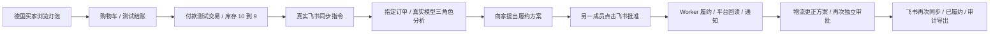
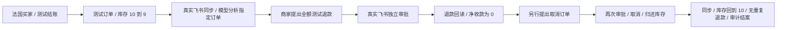
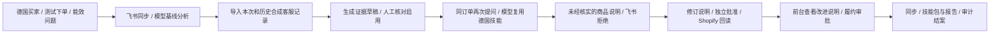

# 三个电商用户完整案例

这里按一个商家的业务目标组织验收。同一案例从买家下单开始，始终关联同一订单和 SKU；消息、分析、方案、审批、平台状态与审计都能在私有验收记录中追溯。

本轮使用真实 Shopify 开发店铺、真实飞书官方 SDK 事件与真实 DeepSeek 请求。买家姓名、邮箱、地址、客服内容、商品与物流单号均为合成测试资料，支付仅使用 Shopify Test Payment Gateway。真实平台凭据与原始截图不进入公开仓库。实际快递运输、采购支付、广告与 Amazon 不在这些案例中。

## 共同准备

1. 创建新的本机组织，导入自己已授权的 Shopify 开发店铺，连接自己的飞书自建机器人。本轮准备由初始化脚本通过应用 API 完成；商家工作台登录和业务操作使用浏览器。这不包含首次浏览器 OAuth 安装流程的完整验收。
2. 邀请另一个应用成员作为审批人，把已核实的测试飞书 Open ID 绑定到该成员。业务申请人和审批人不同。本轮由同一测试操作者控制两个成员身份，验证权限分离，不代表两名自然人参与。
3. 在开发店铺保持测试网关和前台密码保护。创建三个 `xiaokua-test` 商品，每件 19.90 USD，初始库存 10，发布到在线商店。
4. 德国和法国应处于已激活市场；库存必须位于具有配送配置的地点。为三个测试商品单独配置零运费测试配送，不购买物流标签。
5. 启动本机业务服务与飞书 SDK。测试保护开启；模型只分析，不批准或执行平台写入。

买家结账使用 `case-buyer@example.com` 这类保留示例域邮箱；`.invalid` 会被本次测试的结账域名校验拒绝。本机应用登录账号使用 `.invalid` 不受该限制。不要填写真实客户邮箱、地址或卡片，也不要选择真实支付后再退款的方式。

## 案例 A：德国订单从付款到履约、物流更正

德国买家购买一件智能灯泡。商家晨间要求小跨检查待发货订单，独立审批人批准履约，随后仓库更正物流单号，商家确认最终状态。



| 阶段 | 实际操作与验收条件 |
| --- | --- |
| 买家购买 | 前台选购本案例商品，用德国合成地址和官方测试卡号 `1` 下单。成功页截图保存在私有目录。 |
| 订单来源 | Shopify 回读 `sourceName=web`、`order.test=true`、成功收款交易 `test=true / gateway=bogus`；不是调用 `orderCreate` 代替结账。 |
| 库存 | 购买一件后，本案例配送地点的可用库存从 10 降到 9。 |
| 商家启动 | 在真实飞书发 `同步欧洲订单 F-sync`；SDK 事件创建持久任务，完成后收到结果通知。 |
| Agent 分析 | 发 `F-analysis 分析德国订单 #你的订单编号 的待履约与库存情况`。三个角色都调用真实模型，订单和库存证据只属于本案例。 |
| 履约与保护 | 在订单工作台填写合成承运商与追踪号。审批前平台未变化；申请人批准自己的动作被拒绝。另一成员在真实飞书卡片批准，Worker 执行并回读。 |
| 更新快照 | 履约后发 `同步案例履约 F-shipment-sync`，更新本地履约快照，再提出物流更正。 |
| 物流更正 | 以新的合成追踪号再次提案和审批，Shopify 履约信息更新，收到结果通知。 |
| 结案 | 发 `同步案例结果 F-close-sync`，本地快照与 Shopify 都显示已履约，追踪号吻合、无退款；报告和审计可以导出。 |

## 案例 B：法国买家撤销订单、全额测试退款与补库存

法国买家在发货前决定取消订单。商家先核实订单未履约和可退金额，将完整金额退回原测试交易，然后另行取消订单并归还库存。取消动作不能偷偷重复退款。



| 阶段 | 实际操作与验收条件 |
| --- | --- |
| 买家购买 | 本案例自己的商品、法国合成地址、测试网关下单；验证 web 来源和成功测试收款。 |
| 同步与决策依据 | `同步欧洲订单 A-sync` 后，发送 `A-analysis 分析法国订单 #你的订单编号 的取消与退款风险`，三角色真实模型结果通过 Schema 和引用校验。 |
| 全额退款 | 商家按平台剩余可退金额提案，审批卡片显示金额；审批前金额未改变；申请人不能自行批准。实际飞书审批后，原测试交易退款成功且净额为 0。 |
| 取消订单 | 单独提交取消方案并独立审批，平台订单出现取消时间。取消前后的累计退款相同，不重复退款。 |
| 库存与结案 | 可用库存恢复到 10；`同步案例结果 A-close-sync` 后本地快照反映取消和退款状态。财务审计可导出、链校验通过。 |

这验证发货前撤销与财务处理，不表示已经支持实物收货后的退货授权、逆向物流或承运商签收。

## 案例 C：德国买家咨询促成技能学习与商品说明改进

德国买家购买另一件灯泡后，询问能效标签。商家先确认现有知识不足，把这次咨询和此前类似的合成咨询导入。小跨生成有证据的技能草稿，经运营人员核对启用后，再处理同一订单的咨询，并改进商品说明。未经确认的能效等级先被审批人拒绝，最终说明只引用可核对资料。



| 阶段 | 实际操作与验收条件 |
| --- | --- |
| 下单与初次咨询 | 本案例德国测试订单来源为 web。`C-sync` 同步后，`C-baseline 分析德国订单 #你的订单编号 的能源效率咨询`，记录没有已启用技能时的分析。 |
| 经验输入 | 在工作台导入 [案例客服 CSV](../examples/support-journey.csv)：德国能效 5 条、法国退货 5 条。资料没有客户身份信息。 |
| 学习与核对 | 生成两条未启用的证据草稿，运营人员核对后同时启用德国能效和法国退货技能，检验地区筛选；可下载包含 `SKILL.md` 与引用的技能包。 |
| 同问题复用 | 发 `C-reuse 分析德国订单 #你的订单编号 的能源效率咨询`；真实模型知识角色引用德国技能，不能混入法国退货技能。订单与商品证据仍属于本案例。 |
| 拒绝错误承诺 | 申请带未经核实等级的商品说明，真实飞书拒绝；Shopify 原说明保持不变。 |
| 合理改进 | 修订为核对认证标签与适用规格的说明，由另一成员批准；Shopify 与买家前台均能查看新内容。 |
| 履约与结案 | 提出履约并独立审批，完成后以 `C-close-sync` 同步。订单已履约、技能继续可复用，报告、技能包与审计均能导出。 |

客服输入是人工导入；此案例不声称已接入 Shopify Inbox 或自动抓取买家聊天。

## 复现脚本和证据判定

[journey_acceptance.py](../scripts/journey_acceptance.py) 创建私有环境与测试商品，并按阶段读取真实事件、任务、审批、作业和 Shopify 状态。买家结账、飞书发消息、商家提案与卡片审批需要实际浏览器/人员操作，脚本不伪造 SDK 回调，也不绕过独立审批。

```bash
# recipient.json 只存在本机：{"app_id":"你自己的应用 ID","open_id":"核实过的测试成员 ID"}
uv run python scripts/journey_acceptance.py init --recipient-file data/recipient.json
# 使用 init 返回的私有 context 路径替换以下示例。
uv run python scripts/journey_acceptance.py serve api --context data/journey-YOUR_RUN/context.json
# 另一个终端：
uv run python scripts/journey_acceptance.py serve ws --context data/journey-YOUR_RUN/context.json
```

在浏览器完成某案例的测试结账后，读取该案例真实订单，随后依照上面的业务步骤操作：

```bash
uv run python scripts/journey_acceptance.py checkout fulfillment --context data/journey-YOUR_RUN/context.json
uv run python scripts/journey_acceptance.py message fulfillment sync F-sync --context data/journey-YOUR_RUN/context.json
uv run python scripts/journey_acceptance.py message fulfillment analyze F-analysis --context data/journey-YOUR_RUN/context.json
uv run python scripts/journey_acceptance.py proposal fulfillment fulfill F-fulfill --context data/journey-YOUR_RUN/context.json
# 在真实飞书卡片批准以后：
uv run python scripts/journey_acceptance.py action fulfillment fulfill F-fulfill --context data/journey-YOUR_RUN/context.json
```

核验命令只读取平台；`proposal` 还会用申请人尝试自审批，要求系统拒绝，不会代替另一个成员批准。先按故事在浏览器操作，等待作业完成，再按业务顺序逐条运行验证命令。命令写入同一个私有上下文，不能并发运行。

所有阶段的命令参数如下。`message` 的标记要包含在你实际发送的飞书文字中，分析指令还必须含本案例的 `#订单编号` 和市场/主题。`proposal` 在提出方案、卡片送达且尚未批准时运行；`action` 在真实卡片决定和 Worker 执行完成后运行。

| 案例 | 按顺序执行的校验（均追加 `--context data/journey-YOUR_RUN/context.json`） |
| --- | --- |
| A | `checkout fulfillment` → `message fulfillment sync F-sync` → `message fulfillment analyze F-analysis` → `proposal fulfillment fulfill F-fulfill` → `action fulfillment fulfill F-fulfill` → `message fulfillment sync F-shipment-sync` → `proposal fulfillment tracking F-tracking` → `action fulfillment tracking F-tracking` → `message fulfillment sync F-close-sync` |
| B | `checkout aftersales` → `message aftersales sync A-sync` → `message aftersales analyze A-analysis` → `proposal aftersales refund A-refund` → `action aftersales refund A-refund` → `proposal aftersales cancel A-cancel` → `action aftersales cancel A-cancel` → `message aftersales sync A-close-sync` |
| C | `checkout knowledge` → `message knowledge sync C-sync` → `message knowledge analyze C-baseline` → `support` → `message knowledge analyze C-reuse` → `proposal knowledge product C-unsafe` → `action knowledge product C-unsafe --rejected` → `proposal knowledge product C-description` → `action knowledge product C-description` → `frontpage` → `proposal knowledge fulfill C-fulfill` → `action knowledge fulfill C-fulfill` → `message knowledge sync C-close-sync` |

例如，案例 B 的退款是在工作台按 19.90 USD 完整可退金额提案后，再运行 `uv run python scripts/journey_acceptance.py proposal aftersales refund A-refund --context data/journey-YOUR_RUN/context.json`。在真实飞书批准后，以同样参数改用 `action`。案例 C 的 `support` 必须在 CSV 导入、学习、核对并启用两条技能后运行。复用指令需要同时包含“德国”和“能源效率咨询”；不把法国政策当作德国回答证据。

案例 C 的前台验收需要实际打开该商品页、读取渲染后的说明并截图，在私有上下文同目录保存 `frontend-evidence.json`：

```json
{
  "source_url": "https://your-store.myshopify.com/products/YOUR_CASE_HANDLE",
  "description_text": "从实际浏览器商品页读取的完整修订说明，必须与已批准内容一致",
  "screenshot_file": "knowledge-product-after.jpg"
}
```

这里的域名、路径与文字是格式占位符，必须换成自己实际观察的内容。脚本检查资源匹配、说明和截图存在；浏览器读取过程与图片内容还需要测试者人工核对，不能只创建一份 JSON 作为前台成功的证明。带平台标识的截图只保存本机。

若修正后需要重测同一分析阶段，发送一个新的唯一标记，例如 `F-analysis-r2`，再用 `message fulfillment analyze F-analysis-r2 --step F-analysis` 核验。公开记录的阶段名称不变，`observed_at` 保留最后一次真实核验时间；历史尝试仍保存在私有记录。公开步骤按业务阶段排序，时间不伪造。

所有必需步骤和最终状态均通过，才允许生成“完整案例通过”的结果：

```bash
uv run python scripts/journey_acceptance.py finish --context data/journey-YOUR_RUN/context.json --output data/journeys-public-summary.json
```

结案脚本再次查询三笔订单和库存，核对最后的本地快照、无未决动作、全部作业完成、审计链及认证导出。公开摘要严格按字段白名单生成，没有原始平台对象、资源 ID、提示词或模型报告正文。可在 `docs` 目录启动本机 HTTP 服务查看 [脱敏报告界面](journey-evidence.html)；它只显示公开摘要。

缺少前台结账、没有真实 SDK 事件、模型退回规则、订单证据不匹配、没有独立审批、作业失败或最终业务结果不吻合，都会阻止完整案例通过。GitHub Actions 使用离线回归，不附带真实账号，也不运行真实平台写入。

## 设计依据

- [Shopify 测试下单](https://help.shopify.com/en/manual/checkout-settings/test-orders)：测试网关不会实际扣款，验收应覆盖结账、库存和订单处理。
- [可配送库存](https://help.shopify.com/en/manual/inventory-and-locations/setup/fulfillable-inventory)：后台库存存在不代表买家所在区域可以购买。
- [IANA 示例域](https://www.iana.org/help/example-domains)：`example.com` 为保留示例域，适合合成输入；不能当作真实邮件或业务服务。
- [Shopify 退款](https://shopify.dev/docs/api/admin-graphql/2026-10/mutations/refundCreate)、[取消订单](https://shopify.dev/docs/api/admin-graphql/2026-10/mutations/orderCancel)：分别验证财务与取消/补库存结果。
- [飞书官方 SDK 消息与卡片长连接样例](https://github.com/larksuite/oapi-sdk-python/blob/v2_main/samples/ws/sample.py)：读取实际消息与现代卡片回传事件。
- [LangGraph 测试](https://docs.langchain.com/oss/python/langgraph/test)、[DeepSeek JSON 输出](https://api-docs.deepseek.com/guides/json_mode/)：图流程成功与模型输出质量是不同证据，模型输出还需本地引用校验。

三个案例的本轮执行结果和逐阶段图片见 [测试报告](TEST_REPORT.md)，均已完整通过。实际快递运输、售后实物回收、广告和采购支付仍不在这些案例的验收范围。
